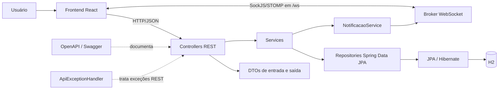
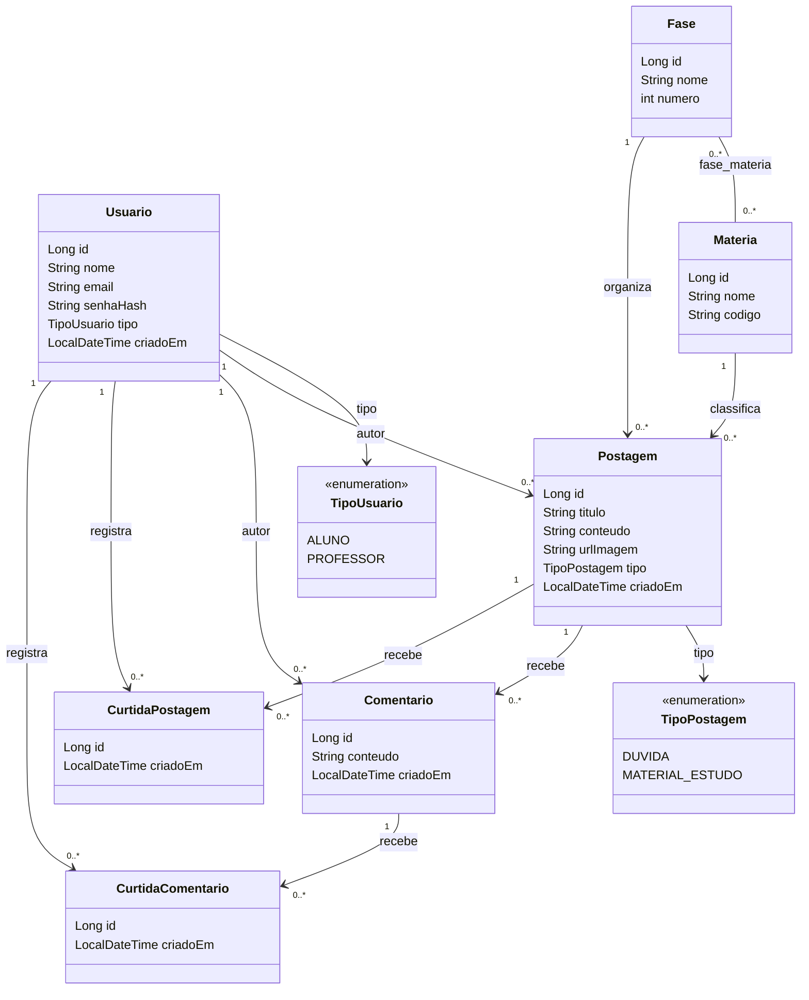
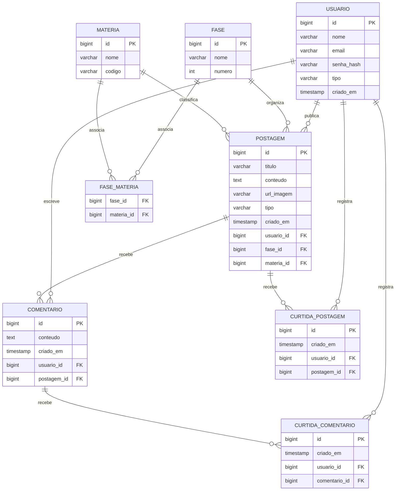
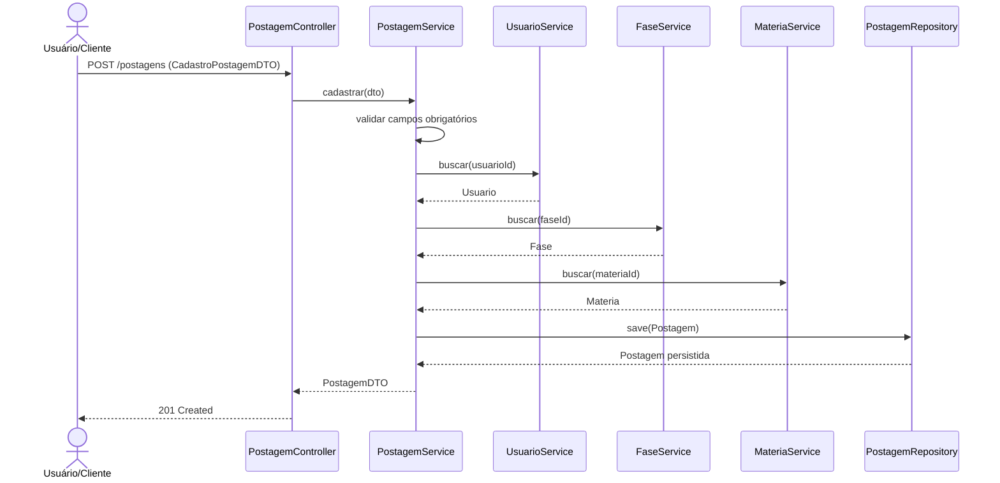
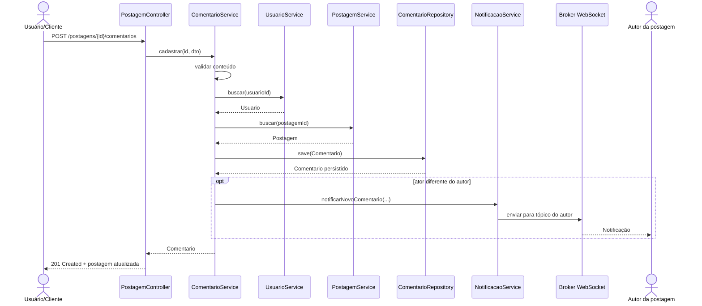
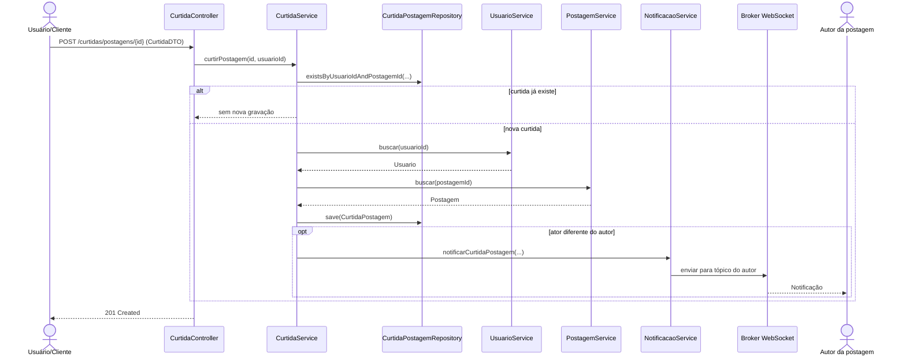

# Arquitetura e modelo de dados

## Arquitetura da aplicação

O frontend React consome a API REST e conecta-se ao endpoint WebSocket `/ws` para receber notificações em tópicos. Controllers definem o contrato HTTP e delegam regras aos services. DTOs definem os payloads expostos, repositories encapsulam o acesso JPA, e as entidades representam os dados persistidos. As notificações são enviadas em tempo real pelo broker simples do Spring; não há entidade de notificação persistida.

## Diagrama de classes das entidades

O diagrama abaixo reflete os atributos e associações JPA das entidades atuais. Não inclui DTOs nem serviços, pois representa o modelo persistido.

`TipoUsuario` é usado pela entidade `Usuario`; `TipoPostagem`, por `Postagem`. `TipoNotificacao` representa o tipo incluído nos DTOs das mensagens WebSocket e não é uma entidade persistida nem uma associação JPA. As coleções de comentários e curtidas são mapeadas com `cascade = ALL` a partir de `Postagem`; as curtidas de comentário também usam `cascade = ALL` a partir de `Comentario`. O relacionamento entre `Fase` e `Materia` é muitos-para-muitos, com tabela associativa `fase_materia`. A associação a usuário, fase, matéria e postagem é obrigatória nas entidades que a declaram como `@ManyToOne(optional = false)`.

## Diagrama entidade-relacionamento

O esquema é gerenciado pelo Hibernate com `ddl-auto=update`; os nomes físicos podem variar conforme a estratégia de nomenclatura configurada pelo Spring Boot. Não há anotação `unique` declarada para e-mail ou para pares usuário/conteúdo das curtidas. O serviço evita duplicar curtidas em chamadas sequenciais, mas uma restrição de unicidade no banco ainda seria necessária para proteger contra concorrência.

## Sequência — publicar postagem

## Sequência — comentar postagem

## Sequência — curtir postagem

## Carregamento de associações

As associações percorridas ao montar DTOs possuem `@BatchSize(size = 50)` e a aplicação configura `hibernate.default_batch_fetch_size=50`. Essa configuração permite que o Hibernate carregue associações lazy em lotes. A redução efetiva de consultas deve ser verificada por teste de integração com estatísticas SQL; a anotação, isoladamente, não prova que todo caminho de leitura esteja livre de N+1.
