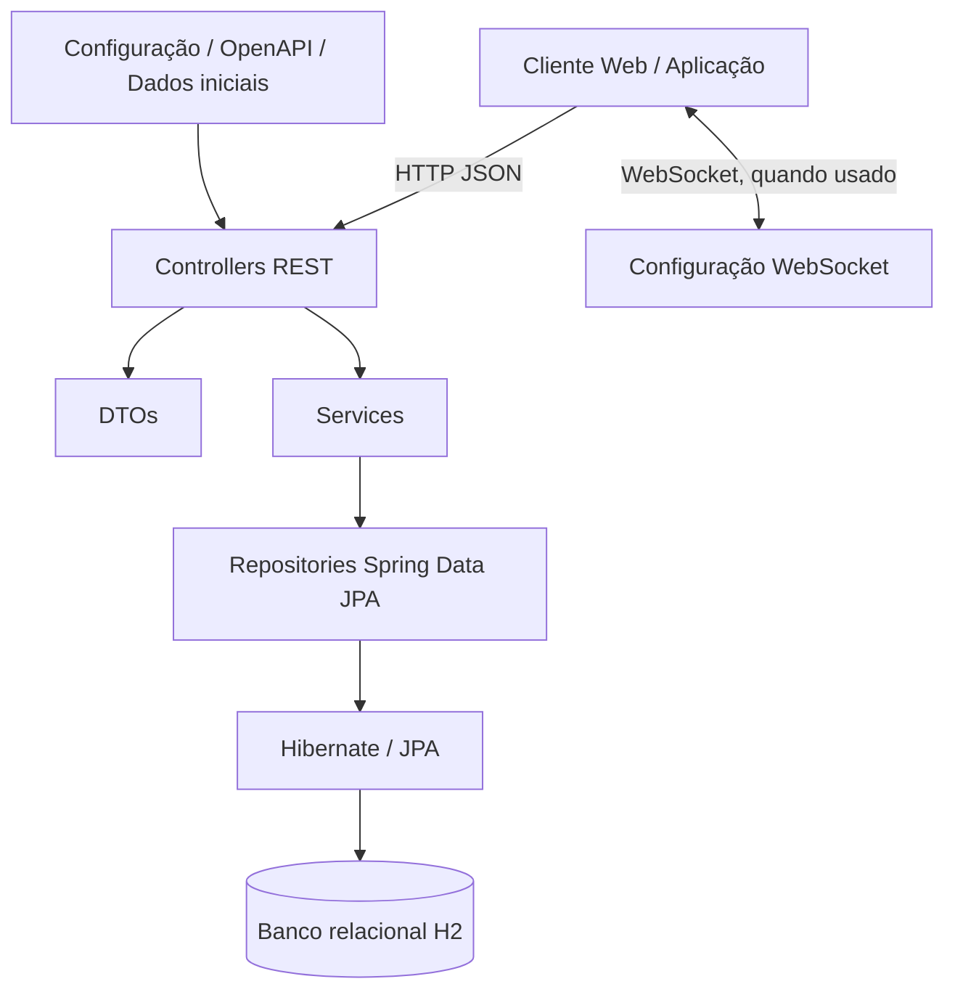
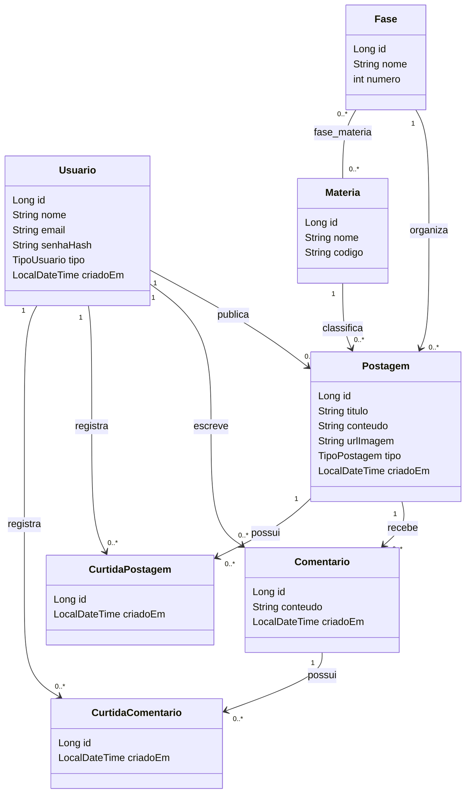
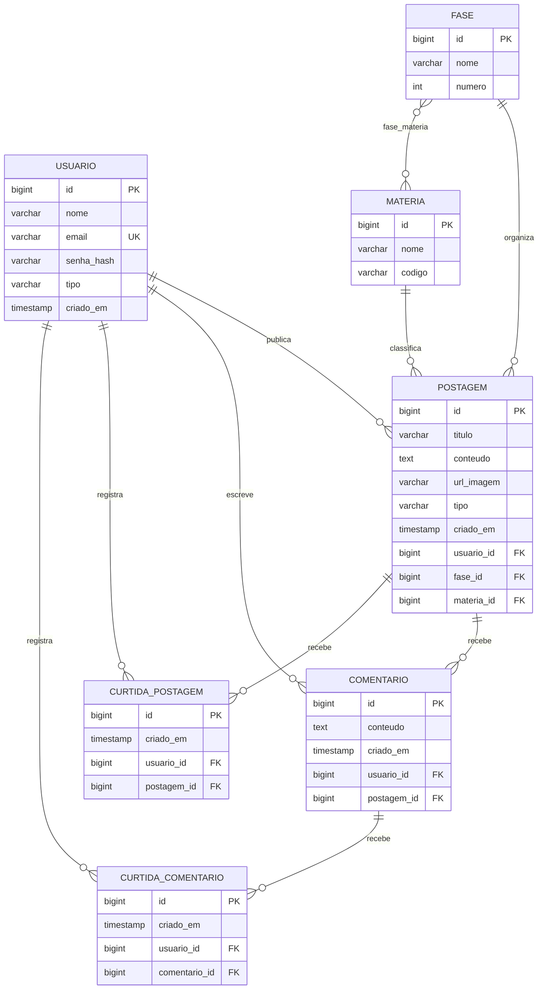
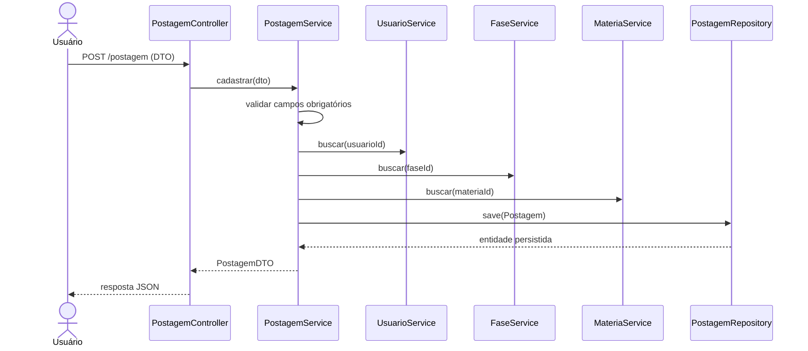

# Arquitetura e modelo de dados

## Arquitetura lógica

Controllers cuidam do protocolo HTTP; services concentram regras de negócio; repositories encapsulam operações de persistência; entities representam tabelas e relacionamentos. DTOs evitam expor diretamente entidades na API.

## Diagrama de classes (modelo estrutural simplificado)

## Diagrama entidade-relacionamento (ER)

**Observação:** os nomes físicos exatos das tabelas/colunas podem ser normalizados pelo Hibernate conforme a estratégia de nomenclatura. `fase_materia` é a tabela associativa do relacionamento muitos-para-muitos. As entidades de curtida não têm ainda uma restrição única para impedir duplicidade do mesmo usuário no mesmo conteúdo; isso é uma melhoria recomendada.

## Fluxo comportamental — publicação

