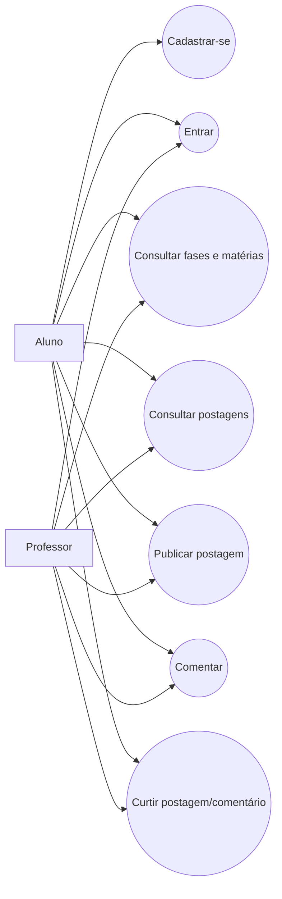

# Casos de uso — ProSIGAA

## Objetivo e atores

O ProSIGAA permite que membros da comunidade acadêmica do IFSC encontrem conteúdos organizados por fase e matéria e interajam com postagens. Atores principais: **Aluno** e **Professor** (especializações de Usuário). A aplicação é o sistema de backend; a interface cliente consome a API REST.

## Casos de uso

| ID | Caso de uso | Ator | Pré-condições | Fluxo principal | Exceções/regras |
|---|---|---|---|---|---|
| UC01 | Cadastrar usuário | Aluno/Professor | E-mail institucional válido | Envia nome, e-mail, senha e tipo; sistema valida e persiste; retorna DTO sem senha | E-mail duplicado ou domínio não permitido retorna HTTP 400 |
| UC02 | Entrar no sistema | Aluno/Professor | Usuário cadastrado | Envia e-mail e senha; sistema verifica credenciais e retorna dados públicos | Credenciais inválidas retornam HTTP 400 no protótipo |
| UC03 | Consultar fases | Usuário | API disponível | Solicita fases; sistema retorna fases e matérias associadas | Lista vazia é válida |
| UC04 | Cadastrar fase | Usuário autorizado no contexto acadêmico | Dados da fase | Sistema valida e salva fase | Protótipo ainda não implementa autorização por papel |
| UC05 | Consultar/cadastrar matéria | Usuário | Fase existente para cadastro | Lista matérias, opcionalmente filtradas por fase, ou cadastra matéria | Fase inexistente ou dados inválidos geram erro |
| UC06 | Consultar postagens | Aluno/Professor | API disponível | Lista por data; opcionalmente filtra por fase e matéria | Filtros podem ser combinados |
| UC07 | Publicar postagem | Aluno/Professor | Usuário, fase e matéria existentes | Envia título, conteúdo, tipo e referências; sistema persiste e retorna postagem | Título/conteúdo/tipo/referências obrigatórios |
| UC08 | Ver postagem | Aluno/Professor | Postagem existente | Solicita identificador e recebe postagem, comentários e contagem de curtidas | Identificador inexistente gera erro |
| UC09 | Comentar postagem | Aluno/Professor | Postagem e usuário existentes | Envia conteúdo e usuário; sistema cria comentário e devolve postagem atualizada | Referências inválidas ou conteúdo vazio geram erro |
| UC10 | Curtir postagem | Aluno/Professor | Postagem e usuário existentes | Envia IDs; sistema registra curtida | IDs inválidos geram erro |
| UC11 | Curtir comentário | Aluno/Professor | Comentário e usuário existentes | Envia IDs; sistema registra curtida | IDs inválidos geram erro |

## Requisitos não funcionais

- API HTTP REST com payloads JSON.
- Persistência relacional por JPA/Hibernate.
- Documentação interativa OpenAPI/Swagger.
- Testes automatizados de unidade e integração.
- Separação em camadas para facilitar manutenção.
- Senhas e autenticação devem ser endurecidas antes de uso real; a autenticação atual é somente protótipo.

## Diagrama de casos de uso (visão textual)

