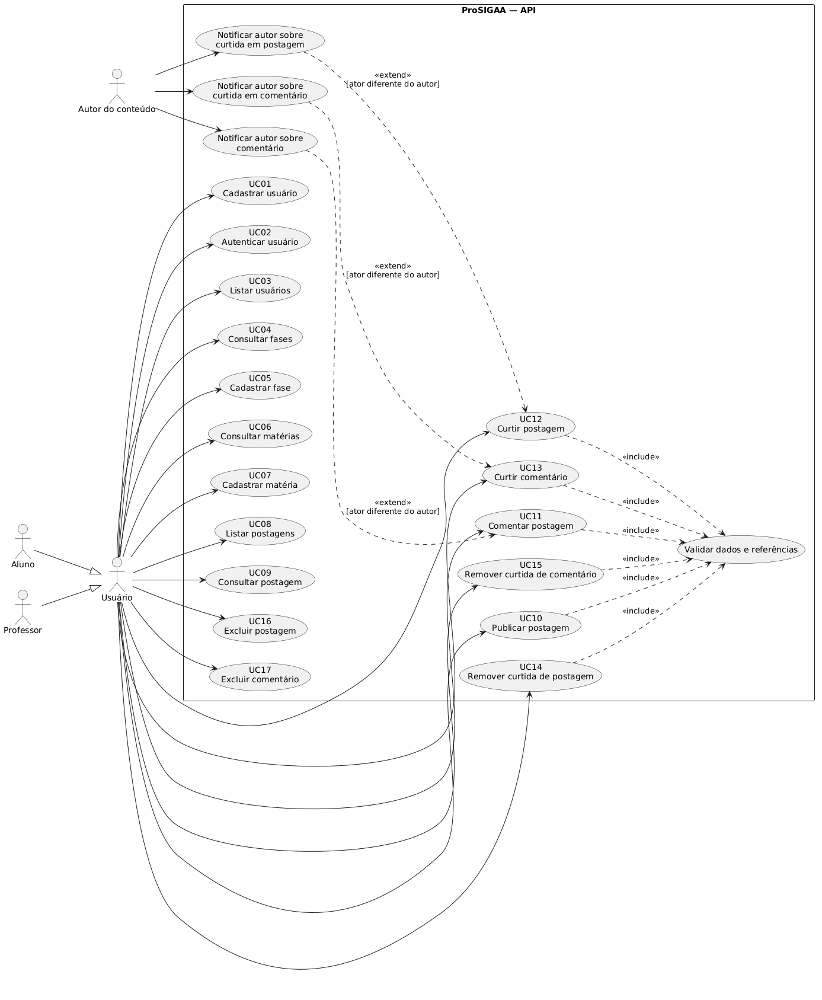

# Casos de uso — ProSIGAA

## Escopo e atores

O ProSIGAA é uma API para cadastro e consulta de usuários, organização de conteúdo acadêmico por fase e matéria e interação com postagens. Os atores abaixo representam quem consome a API; a implementação atual **não** aplica autorização por perfil. O cliente informa `usuarioId` nos comandos que dependem de um usuário.

- **Usuário**: pessoa que consome a API.
- **Aluno** e **Professor**: especializações conceituais de Usuário. O tipo diferencia o perfil exibido, mas não restringe operações no backend.
- **Autor da postagem/comentário**: usuário que recebe notificação quando outra pessoa interage com seu conteúdo.

## Diagrama UML de casos de uso

O diagrama usa notação de casos de uso UML: atores externos, fronteira do sistema e relações `include`/`extend`. Os casos de notificação são extensões condicionais: só ocorrem quando quem interage não é o autor do conteúdo.

O endpoint de notificação de teste (`POST /api/test/notify`) é uma ferramenta técnica, não um caso de uso funcional do fórum, e por isso não aparece no diagrama.

## Especificação dos casos de uso

### UC01 — Cadastrar usuário

- **Ator:** Usuário.
- **Pré-condições:** nenhuma; o e-mail deve pertencer aos domínios institucionais aceitos.
- **Fluxo principal:**
  1. O cliente envia nome, e-mail, senha e, opcionalmente, tipo de usuário para `POST /usuarios`.
  2. O sistema valida o domínio do e-mail e o tamanho mínimo de oito caracteres da senha.
  3. O sistema verifica se o e-mail já está cadastrado e persiste o usuário.
  4. O sistema responde `201 Created` com os dados públicos do usuário, sem senha ou hash.
- **Fluxos alternativos:**
  - 2a. E-mail fora dos domínios permitidos ou senha curta: responde `400 Bad Request`.
  - 3a. E-mail já cadastrado: responde `409 Conflict`.
- **Pós-condição:** usuário cadastrado.

### UC02 — Autenticar usuário

- **Ator:** Usuário.
- **Pré-condições:** usuário cadastrado.
- **Fluxo principal:**
  1. O cliente envia e-mail e senha para `POST /usuarios/sessao`.
  2. O sistema valida as credenciais.
  3. O sistema responde `200 OK` com os dados públicos do usuário.
- **Fluxos alternativos:**
  - 2a. E-mail ou senha inválidos: responde `400 Bad Request` com mensagem genérica.
- **Pós-condição:** credenciais verificadas nesta requisição. A API atual não cria token ou sessão persistente.

### UC03 — Listar usuários

- **Ator:** Usuário.
- **Pré-condições:** API disponível.
- **Fluxo principal:**
  1. O cliente solicita `GET /usuarios`.
  2. O sistema retorna `200 OK` com identificador, nome e tipo de cada usuário.
- **Fluxos alternativos:** nenhum; uma coleção vazia é válida.
- **Pós-condição:** nenhuma alteração de dados.
- **Observação:** a rota não exige autenticação no protótipo. A resposta não contém e-mail, senha ou hash, mas a exposição pública da lista ainda deve ser avaliada antes de uso real.

### UC04 — Consultar fases

- **Ator:** Usuário.
- **Pré-condições:** API disponível.
- **Fluxo principal:**
  1. O cliente solicita `GET /fases`.
  2. O sistema retorna `200 OK` com as fases ordenadas por número e suas matérias associadas.
- **Fluxos alternativos:** nenhuma fase cadastrada resulta em lista vazia.
- **Pós-condição:** nenhuma alteração de dados.

### UC05 — Cadastrar fase

- **Ator:** Usuário.
- **Pré-condições:** API disponível.
- **Fluxo principal:**
  1. O cliente envia nome e número da fase para `POST /fases`.
  2. O sistema persiste a fase.
  3. O sistema responde `201 Created` com os dados da fase.
- **Fluxos alternativos:** corpo inválido resulta em `400 Bad Request`.
- **Pós-condição:** fase cadastrada.
- **Observação:** a API ainda não restringe esse comando a um perfil autorizado.

### UC06 — Consultar matérias

- **Ator:** Usuário.
- **Pré-condições:** API disponível.
- **Fluxo principal:**
  1. O cliente solicita `GET /materias`, opcionalmente com `faseId`.
  2. O sistema retorna `200 OK` com todas as matérias ou apenas as associadas à fase indicada.
- **Fluxos alternativos:** `faseId` em formato inválido resulta em `400 Bad Request`; uma consulta sem resultados retorna lista vazia.
- **Pós-condição:** nenhuma alteração de dados.

### UC07 — Cadastrar matéria

- **Ator:** Usuário.
- **Pré-condições:** fase associada existente.
- **Fluxo principal:**
  1. O cliente envia nome, código e `faseId` para `POST /materias`.
  2. O sistema verifica a fase e associa a matéria a ela.
  3. O sistema responde `201 Created` com os dados da matéria.
- **Fluxos alternativos:**
  - 1a. Corpo inválido: responde `400 Bad Request`.
  - 2a. Fase inexistente: responde `404 Not Found`.
- **Pós-condição:** matéria cadastrada e associada à fase.
- **Observação:** a API ainda não restringe esse comando a um perfil autorizado.

### UC08 — Listar postagens

- **Ator:** Usuário.
- **Pré-condições:** API disponível.
- **Fluxo principal:**
  1. O cliente solicita `GET /postagens`, opcionalmente com `faseId`, `materiaId` ou ambos.
  2. O sistema retorna `200 OK` com as postagens em ordem decrescente de criação, incluindo autores, comentários e contagens de curtidas.
- **Fluxos alternativos:** filtros podem ser combinados; sem resultados, retorna lista vazia. Parâmetros em formato inválido resultam em `400 Bad Request`.
- **Pós-condição:** nenhuma alteração de dados.

### UC09 — Consultar postagem

- **Ator:** Usuário.
- **Pré-condições:** postagem existente.
- **Fluxo principal:**
  1. O cliente solicita `GET /postagens/{id}`.
  2. O sistema retorna `200 OK` com os dados da postagem, comentários e contagens de curtidas.
- **Fluxos alternativos:**
  - 1a. Identificador em formato inválido: responde `400 Bad Request`.
  - 2a. Postagem inexistente: responde `404 Not Found`.
- **Pós-condição:** nenhuma alteração de dados.

### UC10 — Publicar postagem

- **Ator:** Usuário.
- **Pré-condições:** usuário, fase e matéria informados existentes.
- **Fluxo principal:**
  1. O cliente envia título, conteúdo, tipo, `usuarioId`, `faseId` e `materiaId` para `POST /postagens`; a URL de imagem é opcional.
  2. O sistema valida os campos obrigatórios e busca as referências.
  3. O sistema persiste a postagem.
  4. O sistema responde `201 Created` com a postagem criada.
- **Fluxos alternativos:**
  - 1a. Corpo inválido, campo obrigatório ausente ou conteúdo em branco: responde `400 Bad Request`.
  - 2a. Usuário, fase ou matéria inexistente: responde `404 Not Found`.
- **Pós-condição:** postagem disponível para consulta.

### UC11 — Comentar postagem

- **Ator:** Usuário; Autor da postagem recebe notificação quando diferente do ator.
- **Pré-condições:** postagem e usuário existentes.
- **Fluxo principal:**
  1. O cliente envia conteúdo e `usuarioId` para `POST /postagens/{id}/comentarios`.
  2. O sistema valida o conteúdo, busca postagem e usuário e persiste o comentário.
  3. Se o ator não for o autor da postagem, o sistema envia notificação ao autor.
  4. O sistema responde `201 Created` com a postagem atualizada.
- **Fluxos alternativos:**
  - 1a. Conteúdo vazio ou corpo inválido: responde `400 Bad Request`.
  - 2a. Postagem ou usuário inexistente: responde `404 Not Found`.
- **Pós-condição:** comentário associado à postagem.

### UC12 — Curtir postagem

- **Ator:** Usuário; Autor da postagem recebe notificação quando diferente do ator.
- **Pré-condições:** postagem e usuário existentes.
- **Fluxo principal:**
  1. O cliente envia `usuarioId` no corpo de `POST /curtidas/postagens/{postagemId}`.
  2. O sistema verifica se a curtida já existe; se não, valida as referências e persiste a curtida.
  3. Se o ator não for o autor da postagem, o sistema envia notificação ao autor.
  4. O sistema responde `201 Created`.
- **Fluxos alternativos:**
  - 1a. Corpo inválido: responde `400 Bad Request`.
  - 2a. Postagem ou usuário inexistente: responde `404 Not Found`.
  - 2b. Curtida já registrada: a operação é idempotente no serviço e não cria outra; no momento, o controller ainda responde `201 Created`.
- **Pós-condição:** curtida registrada no máximo uma vez por usuário e postagem, conforme verificação do serviço.

### UC13 — Curtir comentário

- **Ator:** Usuário; Autor do comentário recebe notificação quando diferente do ator.
- **Pré-condições:** comentário e usuário existentes.
- **Fluxo principal:**
  1. O cliente envia `usuarioId` no corpo de `POST /curtidas/comentarios/{comentarioId}`.
  2. O sistema verifica se a curtida já existe; se não, valida as referências e persiste a curtida.
  3. Se o ator não for o autor do comentário, o sistema envia notificação ao autor.
  4. O sistema responde `201 Created`.
- **Fluxos alternativos:**
  - 1a. Corpo inválido: responde `400 Bad Request`.
  - 2a. Comentário ou usuário inexistente: responde `404 Not Found`.
  - 2b. Curtida já registrada: não cria duplicata; o controller ainda responde `201 Created`.
- **Pós-condição:** curtida registrada no máximo uma vez por usuário e comentário, conforme verificação do serviço.

### UC14 — Remover curtida de postagem

- **Ator:** Usuário.
- **Pré-condições:** postagem e usuário existentes.
- **Fluxo principal:**
  1. O cliente envia `usuarioId` no corpo de `DELETE /curtidas/postagens/{postagemId}`.
  2. O sistema valida as referências e remove eventual curtida desse usuário na postagem.
  3. O sistema responde `200 OK` com uma mensagem de confirmação.
- **Fluxos alternativos:**
  - 1a. Corpo inválido: responde `400 Bad Request`.
  - 2a. Postagem ou usuário inexistente: responde `404 Not Found`.
  - 2b. Nenhuma curtida correspondente existe: a remoção não altera dados e ainda responde sucesso.
- **Pós-condição:** não há curtida desse usuário para a postagem.

### UC15 — Remover curtida de comentário

- **Ator:** Usuário.
- **Pré-condições:** comentário e usuário existentes.
- **Fluxo principal:**
  1. O cliente envia `usuarioId` no corpo de `DELETE /curtidas/comentarios/{comentarioId}`.
  2. O sistema valida as referências e remove eventual curtida desse usuário no comentário.
  3. O sistema responde `200 OK` com uma mensagem de confirmação.
- **Fluxos alternativos:**
  - 1a. Corpo inválido: responde `400 Bad Request`.
  - 2a. Comentário ou usuário inexistente: responde `404 Not Found`.
  - 2b. Nenhuma curtida correspondente existe: a remoção não altera dados e ainda responde sucesso.
- **Pós-condição:** não há curtida desse usuário para o comentário.

### UC16 — Excluir postagem

- **Ator:** Usuário.
- **Pré-condições:** postagem existente.
- **Fluxo principal:**
  1. O cliente solicita `DELETE /postagens/{id}`.
  2. O sistema localiza e exclui a postagem.
  3. O sistema responde `204 No Content`.
- **Fluxos alternativos:**
  - 1a. Identificador em formato inválido: responde `400 Bad Request`.
  - 2a. Postagem inexistente: responde `404 Not Found`.
- **Pós-condição:** postagem removida; comentários e curtidas dependentes seguem o comportamento de cascata configurado na entidade.
- **Observação:** o backend ainda não verifica se o ator é o autor da postagem.

### UC17 — Excluir comentário

- **Ator:** Usuário.
- **Pré-condições:** comentário existente.
- **Fluxo principal:**
  1. O cliente solicita `DELETE /postagens/comentarios/{comentarioId}`.
  2. O sistema localiza e exclui o comentário.
  3. O sistema responde `204 No Content`.
- **Fluxos alternativos:**
  - 1a. Identificador em formato inválido: responde `400 Bad Request`.
  - 2a. Comentário inexistente: responde `404 Not Found`.
- **Pós-condição:** comentário removido.
- **Observação:** o backend ainda não verifica se o ator é o autor do comentário.

## Requisitos não funcionais relacionados

- API HTTP REST com payloads JSON e contrato documentado via OpenAPI.
- Persistência relacional com JPA/Hibernate.
- Respostas de erro padronizadas e códigos HTTP diferenciados.
- Testes automatizados de unidade e integração.
- Separação em camadas para controllers, serviços e repositórios.
- Autenticação por token, autorização por papel e controle de propriedade ainda não são implementados; as operações descritas refletem o protótipo atual.
