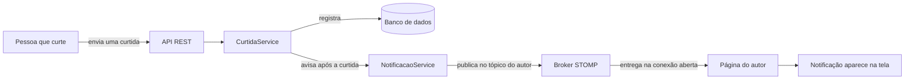
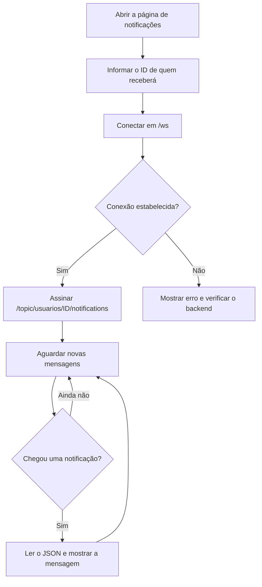
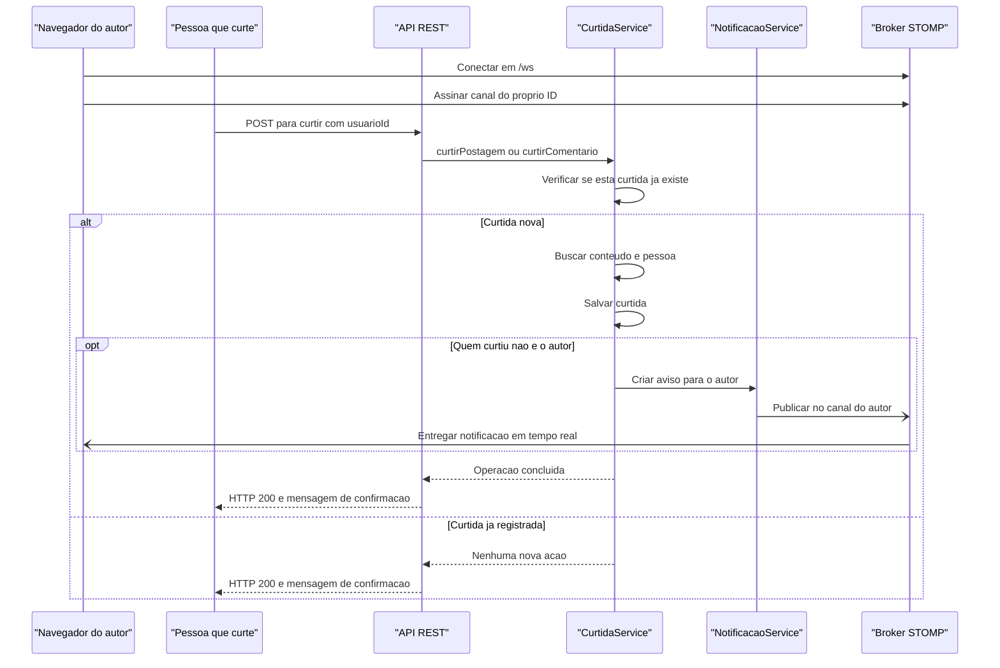
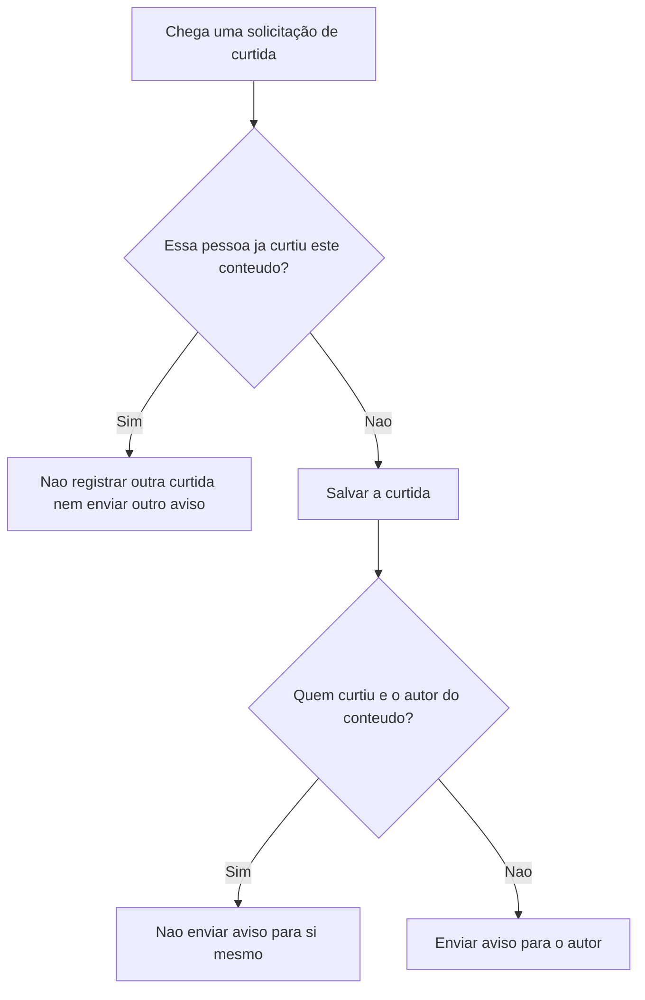
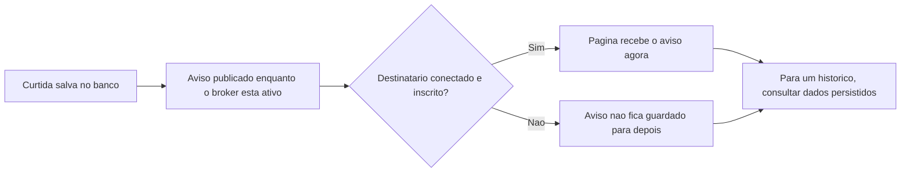

# Notificações em tempo real — WebSocket

## Em poucas palavras

Quando alguém curte uma postagem ou um comentário, o ProSIGAA avisa o autor sem que a página precise ficar consultando a API repetidamente. Para isso, a página mantém uma conexão aberta com o backend e escuta um endereço associado ao ID do usuário que deve receber o aviso.

> **A ideia principal:** o Postman faz a ação de curtir pela API REST; o backend registra a curtida e, em seguida, envia a notificação pela conexão WebSocket que já está aberta no navegador do autor.

## O que acontece



O WebSocket não substitui a API REST. Cada tecnologia tem uma função diferente:

| Canal | Para que serve | Exemplo no ProSIGAA |
|---|---|---|
| REST (HTTP) | Fazer uma solicitação e receber uma resposta | Curtir uma postagem pelo Postman |
| WebSocket com STOMP | Manter uma conexão aberta para receber avisos | Mostrar que alguém curtiu sem atualizar a página |

## Os endereços usados

| O que é | Endereço | Explicação |
|---|---|---|
| Conexão WebSocket | `http://localhost:8080/ws` | A página se conecta ao backend por este endereço; SockJS ajuda a estabelecer a conexão |
| Canal de notificações do usuário | `/topic/usuarios/{usuarioId}/notifications` | A página escuta o canal correspondente ao ID do usuário que receberá os avisos |
| Curtir postagem | `POST /curtida/postagem/{postagemId}?usuarioId={quemCurtiu}` | Solicitação REST enviada pelo Postman ou pelo frontend |
| Curtir comentário | `POST /curtida/comentario/{comentarioId}?usuarioId={quemCurtiu}` | Solicitação REST para curtir um comentário |
| Notificação de teste | `POST /api/test/notify?userId={usuarioId}` | Envia uma mensagem de teste para o canal de uma pessoa; sem `userId`, envia para o canal geral de teste |

`{usuarioId}` e `{postagemId}` são marcadores: substitua-os pelos números reais, sem as chaves. No canal WebSocket, o ID identifica o **destinatário**. No endereço REST de curtida, `usuarioId` identifica **quem está curtindo**. São dois papéis distintos.

## Como a conexão funciona

1. O backend disponibiliza o endpoint `/ws`.
2. A página abre uma conexão usando SockJS e STOMP.
3. Depois de conectada, ela assina `/topic/usuarios/{id}/notifications`.
4. O backend publica avisos nesse mesmo canal quando uma ação relevante acontece.
5. A página recebe a mensagem e pode mostrá-la sem recarregar.



## O caminho de uma curtida

O cliente faz a curtida pela API REST. O serviço grava a curtida e identifica o autor do conteúdo; a notificação é então publicada para o canal desse autor.

<!-- mermaid-checked: every participant uses `participant Id as "Label"`, no \n in aliases/messages/notes, every alt/opt/loop closed by end, no `:` inside any alias -->


**Importante:** receber HTTP `200` confirma a resposta da API de curtida. Isso não significa que a mensagem foi mostrada na página: para recebê-la em tempo real, a página do autor precisa estar conectada e inscrita no canal correto.

## Regras que evitam avisos indevidos



As mesmas regras são aplicadas a curtidas em postagens e em comentários. Os métodos também não publicam uma notificação se faltar o ID do destinatário ou o nome de quem realizou a ação.

## Como testar no navegador e no Postman

O [`index.html`](../../index.html) na raiz do repositório é uma página simples para testar a conexão e visualizar mensagens. Ele não é a aplicação completa; serve como um cliente de demonstração do WebSocket.

### 1. Abra e conecte a página

1. Inicie o backend e confirme que ele está disponível em `http://localhost:8080`.
2. Abra o `index.html` no navegador.
3. Informe o **ID do autor** da postagem ou do comentário.
4. Clique em **Conectar como este usuário**.
5. Aguarde o status **Conectado como usuário ... Aguardando notificações...**.

### 2. Envie a curtida no Postman

Para uma postagem, use:

```http
POST http://localhost:8080/curtida/postagem/7?usuarioId=12
```

Neste exemplo:

- `7` é o ID da postagem;
- `12` é o ID da pessoa que está curtindo;
- a página deve estar conectada usando o ID do **autor da postagem**, que pode ser diferente de `12`.

Para um comentário, use:

```http
POST http://localhost:8080/curtida/comentario/3?usuarioId=12
```

Se a ação for válida, o autor do conteúdo deve ver uma mensagem parecida com **“Ana curtiu sua postagem.”** na lista da página de teste.

### 3. Isole problemas com a notificação de teste

Na página, clique em **Enviar teste para este usuário**. Isso envia um `POST` para `/api/test/notify` sem passar pela regra de curtidas.

- Se o teste aparecer, mas a curtida não, verifique o ID de postagem/comentário, o ID de quem curtiu e se a pessoa já tinha curtido.
- Se o teste não aparecer, confirme que o backend está rodando, que o status da página diz **Conectado** e que o ID no campo é o ID usado para se inscrever.
- Se a página foi aberta antes de o backend iniciar ou perdeu a conexão, conecte novamente antes de repetir o teste.

## Formato da mensagem

As notificações de curtida e comentário são enviadas como JSON usando o contrato `NotificacaoDTO`. Um exemplo simplificado de curtida:

```json
{
  "id": 1730000000000,
  "mensagem": "Ana curtiu sua postagem.",
  "tipoNotificacao": "CURTIDA",
  "postagemId": 7,
  "remetenteNome": "Ana",
  "criadoEm": "2026-10-13T22:30:00"
}
```

Para uma curtida em comentário, o identificador do conteúdo é o ID do comentário; o nome `postagemId` faz parte do DTO existente. Os tipos atualmente definidos são `CURTIDA` e `COMENTARIO`.

O endpoint de teste `/api/test/notify` usa outro formato simplificado (`mensagem`, `tipo` e `timestamp`). Ele existe para testar a conexão e não é o mesmo contrato das notificações de negócio.

## O que o WebSocket atual não faz

- **Não guarda histórico:** o broker simples usado pela aplicação funciona em memória; não é uma caixa de entrada persistente.
- **Não entrega avisos antigos ao reconectar:** se o autor estava desconectado quando a curtida aconteceu, a mensagem não fica esperando para ser recebida depois.
- **Não substitui o banco:** a curtida é registrada pela API e pelas regras do backend; a notificação é apenas o aviso em tempo real.
- **Não autentica o destinatário pelo ID:** o endereço do tópico contém um ID, mas a conexão atual não comprova a identidade da pessoa. Esse canal é adequado ao protótipo/teste, não é privacidade garantida para produção.
- **Não confirma visualização:** o envio ao canal não significa que o usuário viu ou leu o aviso.



Para um sistema em produção, é necessário autenticar a conexão e autorizar cada inscrição pelo usuário autenticado. Se também for preciso guardar notificações para leitura posterior, será necessário persistir esses avisos e disponibilizar uma operação para consultá-los.

## Componentes relacionados

| Componente | Responsabilidade |
|---|---|
| [`WebSocketConfig`](../src/main/java/com/ifsc/prosigaa/config/WebSocketConfig.java) | Habilita STOMP, o broker simples e o endpoint `/ws` com SockJS |
| [`CurtidaController`](../src/main/java/com/ifsc/prosigaa/controller/CurtidaController.java) | Recebe as solicitações REST para curtir |
| [`CurtidaService`](../src/main/java/com/ifsc/prosigaa/service/CurtidaService.java) | Evita repetir a mesma curtida, registra a ação e decide se deve avisar outra pessoa |
| [`ComentarioService`](../src/main/java/com/ifsc/prosigaa/service/ComentarioService.java) | Registra comentários e solicita um aviso ao autor da postagem |
| [`NotificacaoService`](../src/main/java/com/ifsc/prosigaa/service/NotificacaoService.java) | Monta o `NotificacaoDTO` e publica no tópico associado ao destinatário |
| [`NotificacaoWebSocketController`](../src/main/java/com/ifsc/prosigaa/controller/NotificacaoWebSocketController.java) | Disponibiliza a rota de teste `/api/test/notify` |
| [`index.html`](../../index.html) | Cliente de demonstração que conecta, assina um canal e mostra mensagens |
